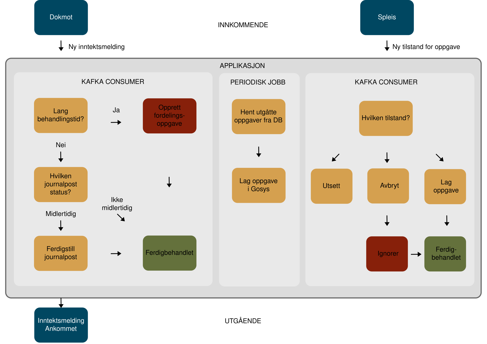
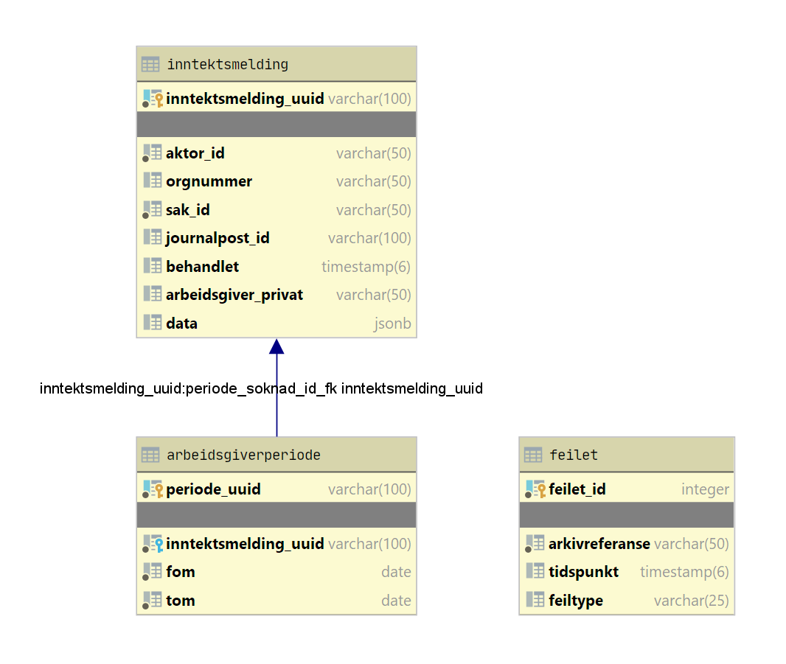

# Syfoinntektsmelding

## Formål
Applikasjonen tar imot innkommende inntektsmeldinger for sykepenger fra Simba og oppretter oppgaver i
Gosys for behandlende enhet. Andre applikasjoner kan be om utsettelse eller ignorering av opprettelser av disse oppgavene.

### Oversikt

## Detaljer om inntektsmelding
Illustrasjonen viser inntektsmeldingen i sin helhet

## Robusthet
Applikasjonen er laget med tanke på aldri miste noen inntektsmeldinger. Dette er løst med disse tiltakene:

#### Oppgave
[FeiletUtsattOppgaveMeldingProsessor](/src/main/kotlin/no/nav/syfo/utsattoppgave/FeiletUtsattOppgaveMeldingProsessor) henter 
ut oppgaver fra køen og sjekker tilstanden. Dersom tilstanden er satt i å opprette blir det opprettet en Gosys-oppgave.

## Varsling om oppgave status
[UtsattOppgaveConsumer](/src/main/kotlin/no/nav/syfo/utsattoppgave/UtsattOppgaveConsumer) lytter på en Kafka kø om det
er oppgaver som skal forkastes eller utsettes. Oppgaver som blir funnet her endrer tilstanden
i køen for Oppgave i avsnittet over.

## Utvikling

### Kjøre applikasjonen lokalt
Om du ønsker å kjøre applikasjonen lokalt, må du starte kafka, zookeeper og database fra lokal docker: 

``
cd docker/local
docker-compose up --remove-orphans
``

Og deretter starte App.kt fra din IDE

### Ktlint

Prosjektet bruker en [Ktlint](https://ktlint.github.io/)-plugin for Gradle som håndhever kodestilregler. Nyttige kommandoer er:

- `gradle lintKotlin` (sier ifra om brudd på kodestilreglene)
- `gradle formatKotlin` (retter opp i brudd på kodestilreglene)

Det anbefales hver utvikler å konfigurere en pre-commit hook som automatisk sjekker endrede filer for brudd på kodestilreglene.
Alternativt kan man sette opp automatisk formattering. Kommandoene for dette er:

- `gradle installKotlinterPrePushHook` (automatisk formattering)

Les mer om pluginen [her](https://github.com/jeremymailen/kotlinter-gradle).

## Database
Applikasjonen bruker Postgres database med JPA grensesnitt OG et JDBC grensesnitt. Skjermbildet nedenfor viser samtlige 
tabeller som er brukt.
Flyway blir brukt til versjonering i databasen.

## For NAV-ansatte
Interne henvendelser kan sendes via Slack i kanalen #helse-arbeidsgiver
